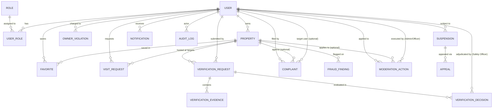

# TrustStay Database Schema & Entity Relationships

This document outlines the complete relational data model for TrustStay. All tables are created and managed incrementally using **Flyway database migrations** to ensure repeatability and consistency across development, testing, and production environments.

---

## 1. Entity Overview (16 Core Entities)

| # | Entity | Domain | Description |
|---|---|---|---|
| 1 | **User** | Identity | Represents tenants, owners, safety officers, and system administrators. |
| 2 | **Role** | Identity / RBAC | Enumerated system permissions (`ROLE_TENANT`, `ROLE_OWNER`, `ROLE_SAFETY_OFFICER`, `ROLE_ADMIN`). |
| 3 | **Property** | Accommodations | Accommodation listings submitted by owners with safety tags, location, pricing, and rules. |
| 4 | **Favorite** | Tenant Activity | Bookmarked properties saved by tenants for quick access. |
| 5 | **VisitRequest** | Accommodations | Scheduled physical or virtual visits requested by tenants and confirmed by owners. |
| 6 | **VerificationRequest** | Safety & Trust | Owner's formal request to verify a property or their personal identity. |
| 7 | **VerificationEvidence** | Safety & Trust | Uploaded proof files (government ID, title deed, utility bill, timestamped video walkthrough). |
| 8 | **VerificationDecision** | Safety & Trust | Outcome recorded by a Safety Officer (`APPROVED`, `REJECTED`, `CHANGES_REQUESTED`) with feedback. |
| 9 | **Complaint** | Safety & Moderation | Grievances filed by tenants or owners regarding false advertising, safety hazards, harassment, etc. |
| 10 | **FraudFinding** | Fraud Detection | Automated or manual flags (duplicate images, suspicious phone numbers, pricing anomalies). |
| 11 | **OwnerViolation** | Safety & Moderation | Formal strikes or infractions registered against an owner account. |
| 12 | **ModerationAction** | Safety & Moderation | Enforcement operations (warning issued, listing unlisted, badge revoked). |
| 13 | **Suspension** | Safety & Moderation | Temporary or permanent lockouts placed on a user or property. |
| 14 | **Appeal** | Safety & Moderation | Formal challenge submitted by an owner against a suspension or negative moderation action. |
| 15 | **Notification** | Communication | In-app alerts for visit updates, verification outcomes, complaints, and account alerts. |
| 16 | **AuditLog** | Compliance & Security | Immutable append-only record tracking all security and moderation events. |

---

## 2. Entity-Relationship Diagram (ERD)

---

## 3. Detailed Entity Fields & Schema Specification

### 3.1 Identity & Access Control
* **`users`**:
  * `id`: BIGSERIAL (Primary Key)
  * `phone_number`: VARCHAR(20) UNIQUE NOT NULL (primary login identifier)
  * `email`: VARCHAR(100) UNIQUE
  * `full_name`: VARCHAR(100) NOT NULL
  * `password_hash`: VARCHAR(255) (optional when using passwordless OTP)
  * `is_phone_verified`: BOOLEAN DEFAULT FALSE
  * `is_identity_verified`: BOOLEAN DEFAULT FALSE
  * `status`: VARCHAR(20) DEFAULT 'ACTIVE' (`ACTIVE`, `SUSPENDED`, `DEACTIVATED`)
  * `created_at`: TIMESTAMP WITH TIME ZONE DEFAULT CURRENT_TIMESTAMP
  * `updated_at`: TIMESTAMP WITH TIME ZONE DEFAULT CURRENT_TIMESTAMP

* **`roles`**:
  * `id`: SERIAL (Primary Key)
  * `name`: VARCHAR(50) UNIQUE NOT NULL (`ROLE_TENANT`, `ROLE_OWNER`, `ROLE_SAFETY_OFFICER`, `ROLE_ADMIN`)
  * `description`: VARCHAR(255)

* **`user_roles`**:
  * `user_id`: BIGINT REFERENCES `users(id)` ON DELETE CASCADE
  * `role_id`: INT REFERENCES `roles(id)` ON DELETE CASCADE
  * PRIMARY KEY (`user_id`, `role_id`)

---

### 3.2 Accommodations & Tenant Interaction
* **`properties`**:
  * `id`: BIGSERIAL (Primary Key)
  * `owner_id`: BIGINT REFERENCES `users(id)` NOT NULL
  * `title`: VARCHAR(200) NOT NULL
  * `description`: TEXT NOT NULL
  * `property_type`: VARCHAR(50) (`APARTMENT`, `HOSTEL`, `PG_CO_LIVING`, `STUDIO`)
  * `target_tenant_type`: VARCHAR(50) (`STUDENTS_ONLY`, `PROFESSIONALS_ONLY`, `ANY`)
  * `gender_preference`: VARCHAR(30) (`FEMALE_ONLY`, `MALE_ONLY`, `CO_ED`)
  * `rent_amount`: DECIMAL(10, 2) NOT NULL
  * `deposit_amount`: DECIMAL(10, 2) NOT NULL
  * `address_line1`: VARCHAR(255) NOT NULL
  * `city`: VARCHAR(100) NOT NULL
  * `state`: VARCHAR(100) NOT NULL
  * `postal_code`: VARCHAR(20) NOT NULL
  * `latitude`: DECIMAL(10, 7)
  * `longitude`: DECIMAL(10, 7)
  * `cctv_present`: BOOLEAN DEFAULT FALSE
  * `security_guard`: BOOLEAN DEFAULT FALSE
  * `biometric_access`: BOOLEAN DEFAULT FALSE
  * `curfew_time`: VARCHAR(20)
  * `verification_status`: VARCHAR(30) DEFAULT 'UNVERIFIED' (`UNVERIFIED`, `PENDING`, `VERIFIED`, `REJECTED`)
  * `is_active`: BOOLEAN DEFAULT TRUE
  * `created_at`: TIMESTAMP WITH TIME ZONE DEFAULT CURRENT_TIMESTAMP

* **`favorites`**:
  * `id`: BIGSERIAL (Primary Key)
  * `user_id`: BIGINT REFERENCES `users(id)` ON DELETE CASCADE
  * `property_id`: BIGINT REFERENCES `properties(id)` ON DELETE CASCADE
  * `created_at`: TIMESTAMP WITH TIME ZONE DEFAULT CURRENT_TIMESTAMP
  * UNIQUE (`user_id`, `property_id`)

* **`visit_requests`**:
  * `id`: BIGSERIAL (Primary Key)
  * `property_id`: BIGINT REFERENCES `properties(id)` ON DELETE CASCADE
  * `tenant_id`: BIGINT REFERENCES `users(id)` ON DELETE CASCADE
  * `requested_slot`: TIMESTAMP WITH TIME ZONE NOT NULL
  * `visit_type`: VARCHAR(20) DEFAULT 'IN_PERSON' (`IN_PERSON`, `VIRTUAL_CALL`)
  * `status`: VARCHAR(30) DEFAULT 'PENDING' (`PENDING`, `CONFIRMED`, `COMPLETED`, `CANCELLED`, `DECLINED`)
  * `notes`: TEXT
  * `created_at`: TIMESTAMP WITH TIME ZONE DEFAULT CURRENT_TIMESTAMP

---

### 3.3 Safety, Verification & Evidence
* **`verification_requests`**:
  * `id`: BIGSERIAL (Primary Key)
  * `property_id`: BIGINT REFERENCES `properties(id)`
  * `owner_id`: BIGINT REFERENCES `users(id)`
  * `status`: VARCHAR(30) DEFAULT 'SUBMITTED' (`SUBMITTED`, `IN_REVIEW`, `APPROVED`, `REJECTED`)
  * `submitted_at`: TIMESTAMP WITH TIME ZONE DEFAULT CURRENT_TIMESTAMP

* **`verification_evidence`**:
  * `id`: BIGSERIAL (Primary Key)
  * `verification_request_id`: BIGINT REFERENCES `verification_requests(id)` ON DELETE CASCADE
  * `document_type`: VARCHAR(50) (`OWNERSHIP_DEED`, `UTILITY_BILL`, `ID_PROOF`, `WALKTHROUGH_VIDEO`)
  * `file_url`: VARCHAR(500) NOT NULL
  * `file_hash`: VARCHAR(64) (for anti-tampering)
  * `uploaded_at`: TIMESTAMP WITH TIME ZONE DEFAULT CURRENT_TIMESTAMP

* **`verification_decisions`**:
  * `id`: BIGSERIAL (Primary Key)
  * `verification_request_id`: BIGINT REFERENCES `verification_requests(id)`
  * `officer_id`: BIGINT REFERENCES `users(id)`
  * `decision`: VARCHAR(30) NOT NULL (`APPROVED`, `REJECTED`, `NEEDS_MORE_INFO`)
  * `rejection_reason`: TEXT
  * `decided_at`: TIMESTAMP WITH TIME ZONE DEFAULT CURRENT_TIMESTAMP

---

### 3.4 Complaints, Fraud & Moderation
* **`complaints`**:
  * `id`: BIGSERIAL (Primary Key)
  * `complainant_id`: BIGINT REFERENCES `users(id)`
  * `property_id`: BIGINT REFERENCES `properties(id)` NULL
  * `reported_user_id`: BIGINT REFERENCES `users(id)` NULL
  * `category`: VARCHAR(50) (`FAKE_LISTING`, `SAFETY_HAZARD`, `HARASSMENT`, `FINANCIAL_FRAUD`)
  * `description`: TEXT NOT NULL
  * `status`: VARCHAR(30) DEFAULT 'OPEN' (`OPEN`, `INVESTIGATING`, `RESOLVED`, `DISMISSED`)
  * `created_at`: TIMESTAMP WITH TIME ZONE DEFAULT CURRENT_TIMESTAMP

* **`fraud_findings`**:
  * `id`: BIGSERIAL (Primary Key)
  * `property_id`: BIGINT REFERENCES `properties(id)`
  * `source`: VARCHAR(30) (`AI_MICROSERVICE`, `MANUAL_REPORT`)
  * `risk_score`: DECIMAL(5, 2) (0.00 to 100.00)
  * `flags`: JSONB (e.g. `{"duplicate_images": true, "unrealistic_pricing": true}`)
  * `detected_at`: TIMESTAMP WITH TIME ZONE DEFAULT CURRENT_TIMESTAMP

* **`owner_violations`**:
  * `id`: BIGSERIAL (Primary Key)
  * `owner_id`: BIGINT REFERENCES `users(id)`
  * `complaint_id`: BIGINT REFERENCES `complaints(id)` NULL
  * `severity`: VARCHAR(20) (`LOW`, `MEDIUM`, `HIGH`, `CRITICAL`)
  * `details`: TEXT NOT NULL
  * `issued_at`: TIMESTAMP WITH TIME ZONE DEFAULT CURRENT_TIMESTAMP

* **`moderation_actions`**:
  * `id`: BIGSERIAL (Primary Key)
  * `moderator_id`: BIGINT REFERENCES `users(id)`
  * `target_user_id`: BIGINT REFERENCES `users(id)`
  * `target_property_id`: BIGINT REFERENCES `properties(id)` NULL
  * `action_type`: VARCHAR(50) (`WARNING`, `DELIST_PROPERTY`, `SUSPEND_ACCOUNT`, `PERMANENT_BAN`)
  * `reason`: TEXT NOT NULL
  * `created_at`: TIMESTAMP WITH TIME ZONE DEFAULT CURRENT_TIMESTAMP

* **`suspensions`**:
  * `id`: BIGSERIAL (Primary Key)
  * `user_id`: BIGINT REFERENCES `users(id)`
  * `start_date`: TIMESTAMP WITH TIME ZONE DEFAULT CURRENT_TIMESTAMP
  * `end_date`: TIMESTAMP WITH TIME ZONE NULL (null means indefinite/permanent)
  * `is_active`: BOOLEAN DEFAULT TRUE
  * `reason`: TEXT NOT NULL

* **`appeals`**:
  * `id`: BIGSERIAL (Primary Key)
  * `suspension_id`: BIGINT REFERENCES `suspensions(id)`
  * `appellant_id`: BIGINT REFERENCES `users(id)`
  * `grounds_for_appeal`: TEXT NOT NULL
  * `supporting_doc_url`: VARCHAR(500)
  * `status`: VARCHAR(30) DEFAULT 'PENDING' (`PENDING`, `GRANTED`, `DENIED`)
  * `reviewed_by`: BIGINT REFERENCES `users(id)` NULL
  * `reviewed_at`: TIMESTAMP WITH TIME ZONE NULL

---

### 3.5 Communications & Audit Logs
* **`notifications`**:
  * `id`: BIGSERIAL (Primary Key)
  * `user_id`: BIGINT REFERENCES `users(id)` ON DELETE CASCADE
  * `title`: VARCHAR(150) NOT NULL
  * `message`: TEXT NOT NULL
  * `type`: VARCHAR(50) (`VISIT_UPDATE`, `VERIFICATION_STATUS`, `SAFETY_ALERT`, `SYSTEM`)
  * `is_read`: BOOLEAN DEFAULT FALSE
  * `created_at`: TIMESTAMP WITH TIME ZONE DEFAULT CURRENT_TIMESTAMP

* **`audit_logs`**:
  * `id`: BIGSERIAL (Primary Key)
  * `actor_id`: BIGINT REFERENCES `users(id)` NULL (null for system events)
  * `action`: VARCHAR(100) NOT NULL (e.g. `USER_LOGIN_OTP`, `VERIFICATION_APPROVED`, `PROPERTY_DELISTED`)
  * `entity_name`: VARCHAR(50) (e.g. `Property`, `User`, `Suspension`)
  * `entity_id`: VARCHAR(50)
  * `client_ip`: VARCHAR(45)
  * `user_agent`: VARCHAR(255)
  * `details`: JSONB
  * `timestamp`: TIMESTAMP WITH TIME ZONE DEFAULT CURRENT_TIMESTAMP
