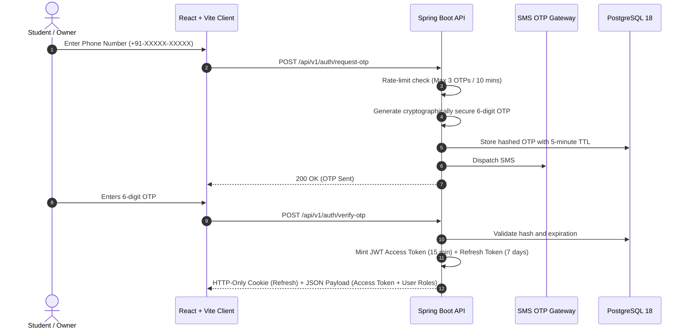
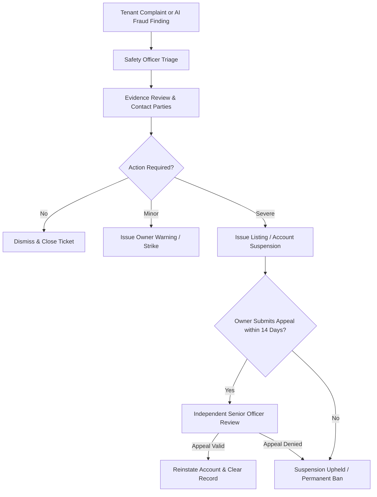

# TrustStay Security & Moderation Framework

TrustStay is built with a "safety-first" philosophy. The security architecture guarantees user privacy, prevents unauthorized account access, and provides transparent recourse through human-in-the-loop moderation.

---

## 1. Authentication & Phone OTP Architecture

### Key Security Safeguards
* **No Hardcoded Secrets**: Secrets such as `JWT_SECRET`, database passwords, and SMS API keys are retrieved from environment variables.
* **OTP Brute-Force Defense**: Failed attempts are capped at 5 consecutive tries before a mandatory 30-minute lockout.
* **Secure Token Storage**: Refresh tokens are issued inside strict `HttpOnly`, `SameSite=Strict`, `Secure` cookies to protect against XSS (Cross-Site Scripting).

---

## 2. Role-Based Access Control (RBAC)

TrustStay organizes platform roles with clear authorization boundaries:

| Role | Key Capabilities |
| :--- | :--- |
| **`ROLE_TENANT`** | Browse verified properties, filter by safety tags, save favorites, submit visit requests, report listings/complaints. |
| **`ROLE_OWNER`** | Create and manage accommodation listings, submit verification documents, manage visit requests, file appeals. |
| **`ROLE_SAFETY_OFFICER`** | Review verification evidence queues, approve/reject property trust badges, investigate tenant safety complaints. |
| **`ROLE_ADMIN`** | Execute platform-wide moderation actions (suspensions, permanent bans), configure system parameters, audit all logs. |

---

## 3. Moderation & Suspension Lifecycle

---

## 4. Immutable Audit Logging

Every critical event is written to the `audit_logs` table:
* Who performed the action (`actor_id`, IP address, user-agent).
* What was modified (`entity_name`, `entity_id`).
* Exact payload changes (`before` and `after` state in JSONB).
* Timestamps generated securely by the database (`CURRENT_TIMESTAMP`).
